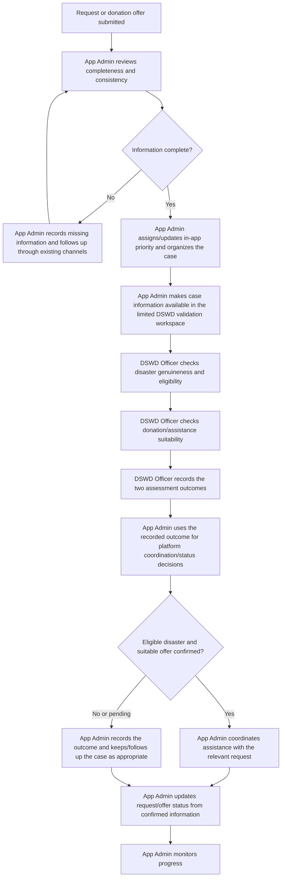

# Activity diagram: external disaster and donation validation

DSWD is an application user only within the limited validation workspace; DSWD's official systems remain external. There is no system-to-system integration or automatic transfer. The current validation queue and decisions are demonstration data in browser memory, not persisted by the API.
