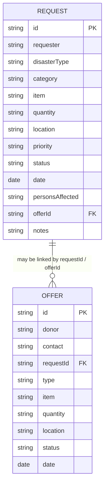

# Data model and ERD

## Inspection result

The inspected backend data source is `bayanihanlink-be/data/db.json`. It contains root arrays named `requests`, `offers`, and `notes`; it is a file-backed JSON store. The project has no MongoDB dependency, Mongo connection, schema/model definitions, or MongoDB collections. No data records or collection-like arrays were removed for the role-separation change.

Current observed fields:

- `requests`: `id`, `requester`, `disasterType`, `category`, `item`, `quantity`, `location`, `priority`, `status`, `date`, `personsAffected`, `offerId`, `notes`.
- `offers`: `id`, `donor`, `contact`, `requestId`, `type`, `item`, `quantity`, `location`, `status`, `date`.
- `notes`: empty in the inspected file; retain it until its intended use is confirmed.

There is no user/account array or collection. Do not add or remove one as part of role separation without an approved authentication/account design. The JSON API is currently read-only; the coordination UI does not persist notes or status changes.

## Entity relationship view

The JSON file does not enforce these links as database foreign keys; identifiers are application-level references. `notes` is a root array in the actual JSON store and is not shown as a relational entity because its current contents/schema are empty/unknown.

## Role boundary

DSWD is not an entity/account in this data model. Any DSWD confirmation is information the App Admin obtains externally and records in existing request/offer status or notes fields. This documentation does not assert that the current prototype already persists that update.
